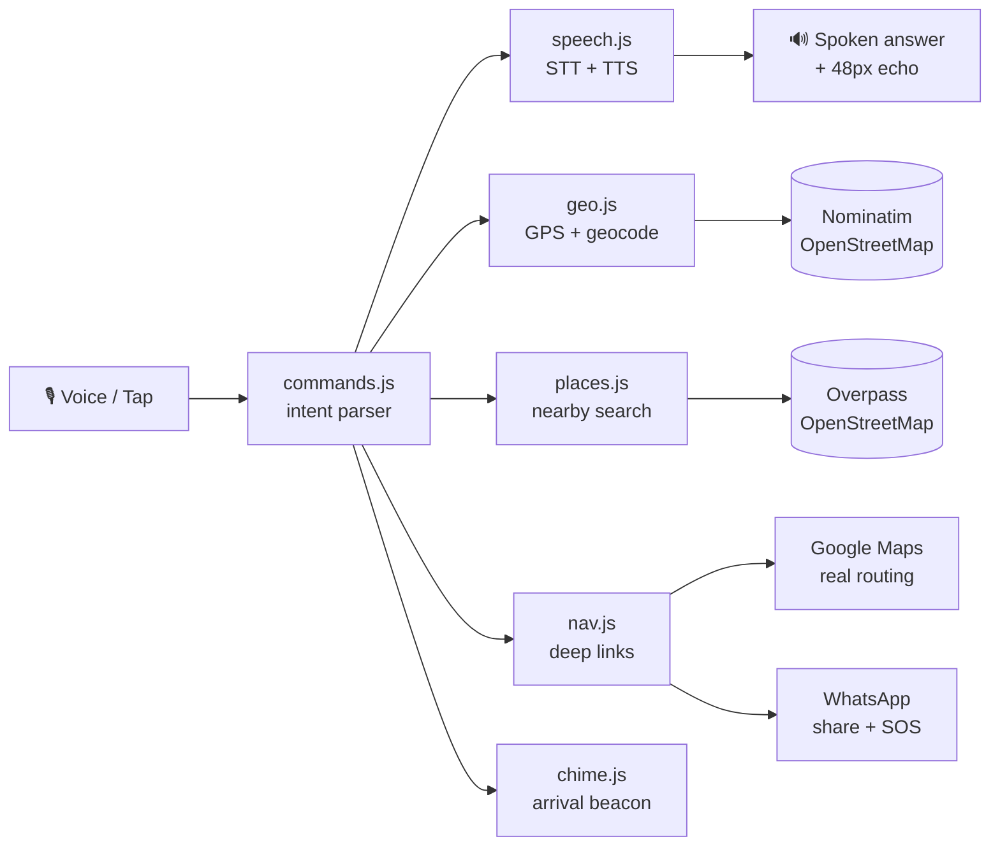

<p align="center">
  
</p>

<h1 align="center">Disha</h1>

<p align="center"><em>Built entirely by voice, for people who navigate the world by voice.</em></p>

<p align="center">
  <a href="https://<your-username>.github.io/disha">
    
  </a>
</p>

<p align="center">
  
  
  
  
  
</p>

<p align="center">
  A voice-first navigation companion for blind and low-vision users.<br>
  One giant button, voice in, voice out — an accessibility layer over Google Maps,<br>
  <strong>not</strong> another routing engine. No map to squint at. Just speak and go.
</p>

---

## 🎙️ Experience it in 60 seconds

1. Open the **[live demo](https://<your-username>.github.io/disha)** on Android Chrome *(replace the URL after you deploy — see [Deploy](#-deploy))*.
2. Tap the big yellow **TALK** button and say **"where am I"** → your phone speaks your address.
3. Say **"remember home"**, then **"take me home"** → Google Maps opens with walking directions.
4. Say **"what's near me"** → hear the 3 closest pharmacies, hospitals, bus stops.

Noisy street? Every command below also exists as a giant tap button — zero voice needed.

---

## ✨ What it can do — tap a card to try the command

<details>
<summary><strong>📍 "where am I"</strong> — spoken street address</summary>

Say it (or tap *Where am I*). Disha grabs your GPS, reverse-geocodes it via OpenStreetMap, and **speaks your address aloud** in 48px type on screen.
<br><br>
Hindi: *"मैं कहाँ हूँ"*
</details>

<details>
<summary><strong>🏠 "remember home" / "take me home"</strong> — voice-labeled favorites</summary>

Stand somewhere → **"remember home"** saves it. Later, anywhere → **"take me home"** opens Google Maps walking navigation. Works for any label: *"remember office"* → *"take me office"*.
<br><br>
Hindi: *"घर याद रखो"* → *"घर ले चलो"*
</details>

<details>
<summary><strong>🔍 "take me to Connaught Place"</strong> — any place on Earth</summary>

Searches OpenStreetMap and hands the coordinates to Google Maps. No favorites needed.
<br><br>
Hindi: *"कनॉट प्लेस ले चलो"*
</details>

<details>
<summary><strong>💊 "what's near me"</strong> — pharmacies, hospitals, bus stops, ATMs</summary>

Queries OpenStreetMap live and **speaks the 3 closest**, with distances: *"City Pharmacy, 200 meters."* Free, no API key.
<br><br>
Hindi: *"आसपास क्या है"*
</details>

<details>
<summary><strong>📌 "remember this spot" / "take me back"</strong> — breadcrumb pin</summary>

In an unfamiliar place? Drop a pin. Later, **"take me back"** opens the route *and* starts the arrival chime.
<br><br>
Hindi: *"यह जगह याद रखो"* → *"वापस ले चलो"*
</details>

<details>
<summary><strong>🔔 Arrival chime</strong> — hotter/colder audio for the last 100 m</summary>

The stretch where Maps says *"you have arrived"* while you're across the street. Disha beeps — **faster as you get closer** — and announces arrival under ~12 m.
</details>

<details>
<summary><strong>💬 "share my trip"</strong> — companion mode</summary>

One command opens WhatsApp with your **live location** prefilled — a family member can follow you in real time. Safety for solo travel.
</details>

<details>
<summary><strong>🆘 "help me"</strong> — emergency in one breath</summary>

Speaks your address aloud **and** WhatsApps your emergency contact with your location. Set it once: *"my emergency number is 919876543210"* (include country code).
<br><br>
Hindi: *"मदद"*
</details>

<details>
<summary><strong>🌐 "speak hindi"</strong> — full Hindi voice mode</summary>

Switches speech recognition, voice responses, and templates to Hindi. *"मैं कहाँ हूँ"* just works.
</details>

---

## 🗺️ How it works



**The honest architecture:** Disha never routes — that's Google's job, done better than a 2-day build ever could. Disha is the *interface layer Google forgot*: eyes-free, voice-first, one job per command. Local-first, zero backend, nothing to leak.

---

## 🎬 Demo script (for the submission recording, ~2 min)

**Cold open (60 seconds):**
- [ ] Open the deployed URL on Android Chrome — Wispr Flow mic overlay visible
- [ ] Tap TALK → *"take me home"* → Google Maps opens with walking directions
- [ ] Back → *"where am I"* → phone speaks the address
- [ ] *"What's near me"* → phone speaks 3 nearby places with distances

**Extended (60 seconds):**
- [ ] *"Remember this spot"* → *"take me back"* → chime demo
- [ ] Toggle हिं → *"मैं कहाँ हूँ"* → Hindi response
- [ ] *"Share my trip"* → WhatsApp opens with live location

---

## 💻 Run locally

```bash
python3 -m http.server 8000
# open http://localhost:8000 — mic + GPS work on localhost
```

> **HTTPS is required on a phone.** Chrome enables microphone + GPS only in secure contexts. `file://` will not work — the app shows a warning banner if opened insecurely.

---

## 🚀 Deploy

<details>
<summary><strong>GitHub Pages</strong> (recommended — free HTTPS included)</summary>

```bash
git init -b main
git add .
git commit -m "Disha v1.0 — voice navigation companion"
# create an empty repo named "disha" on github.com, then:
git remote add origin https://github.com/<your-username>/disha.git
git push -u origin main
```

Then: repo → **Settings → Pages** → Source: **Deploy from branch** → `main` → `/(root)` → **Save**. Live in ~1 minute at `https://<your-username>.github.io/disha`. Update the demo links at the top of this README with your URL.
</details>

<details>
<summary><strong>Netlify / Vercel / Cloudflare Pages</strong></summary>

Import the repo, publish directory = `/` (repo root), no build command. Add env vars in their dashboard if you ever use API keys (see below).
</details>

---

## 🧱 Codebase structure

<details>
<summary>Click to expand the module map</summary>

```
disha/
├── index.html            # app shell (loads css/ + js/ as ES modules)
├── manifest.json         # PWA manifest
├── icon.svg              # app icon
├── css/
│   └── styles.css        # refined minimal dark design system
├── js/
│   ├── main.js           # bootstrap: wires buttons, language, env guards
│   ├── config.js         # central config; reads keys, never hardcodes them
│   ├── i18n.js           # English + Hindi response templates
│   ├── store.js          # localStorage: settings, favorites, breadcrumb
│   ├── ui.js             # DOM refs, status/transcript/response rendering
│   ├── speech.js         # voice in (recognition) + voice out (synthesis)
│   ├── geo.js            # geolocation + Nominatim geocoding
│   ├── places.js         # "what's near me" via Overpass API
│   ├── nav.js            # deep links: Google Maps + WhatsApp
│   ├── chime.js          # arrival beacon (hotter/colder audio, final 100 m)
│   └── commands.js       # voice intent parsing + handlers (EN + HI)
├── scripts/
│   └── inject-env.js     # .env -> js/env.generated.js (zero dependencies)
├── docs/                 # PRD, TRD, UI/UX, Architecture (v1.0)
├── .env.example          # key holders (committed) — copy to .env
├── .env                  # your real keys (gitignored, never committed)
└── .gitignore
```
</details>

---

## 🔑 Environment & API keys

<details>
<summary>The professional setup — keyless today, ready for tomorrow</summary>

Disha runs **fully keyless** on OpenStreetMap. When you need a key later (embedded maps, weather), the plumbing is ready:

```bash
cp .env.example .env       # fill in values — .env is gitignored, never commit it
node scripts/inject-env.js  # generates js/env.generated.js (also gitignored)
```

`js/config.js` picks up `window.__DISHA_ENV__` automatically — keys are never hardcoded in source.
</details>

---

## ✅ Submission checklist

- [ ] Deployed over HTTPS (URL works on mobile data, not just wifi)
- [ ] Screen recording shows the **build process** (Wispr Flow dictation → working app), not just the result
- [ ] Cold-open demo works first try on Android Chrome
- [ ] Narrative: *"I didn't rebuild routing — I built the interface layer Google forgot."*

---

## ❓ FAQ

<details>
<summary><strong>Why not just use Google Maps?</strong></summary>

Maps is a visual-map app with voice bolted on — try entering a destination without looking at the screen. Disha is voice-first from the ground up: one button, one command, one job. It *uses* Maps for routing instead of competing with it.
</details>

<details>
<summary><strong>Does it work on iPhone?</strong></summary>

Partially — iOS Safari has no Web Speech recognition, so voice input won't work, but every command exists as a giant tap button and voice *output* works fine. Demo on Android Chrome for the full experience.
</details>

<details>
<summary><strong>Is my location uploaded anywhere?</strong></summary>

No. Everything stays on your device except the map lookups you explicitly trigger (address search, nearby places). No accounts, no analytics, no tracking.
</details>

<details>
<summary><strong>Was this really built by voice?</strong></summary>

Yes — every line was dictated through Wispr Flow; no code was typed by hand. The screen recording in the submission shows the process.
</details>

---

## 📄 Docs

Full spec pack (v1.0, conformance-verified): [`docs/PRD.md`](docs/PRD.md) · [`docs/TRD.md`](docs/TRD.md) · [`docs/UI_UX.md`](docs/UI_UX.md) · [`docs/ARCHITECTURE.md`](docs/ARCHITECTURE.md)
